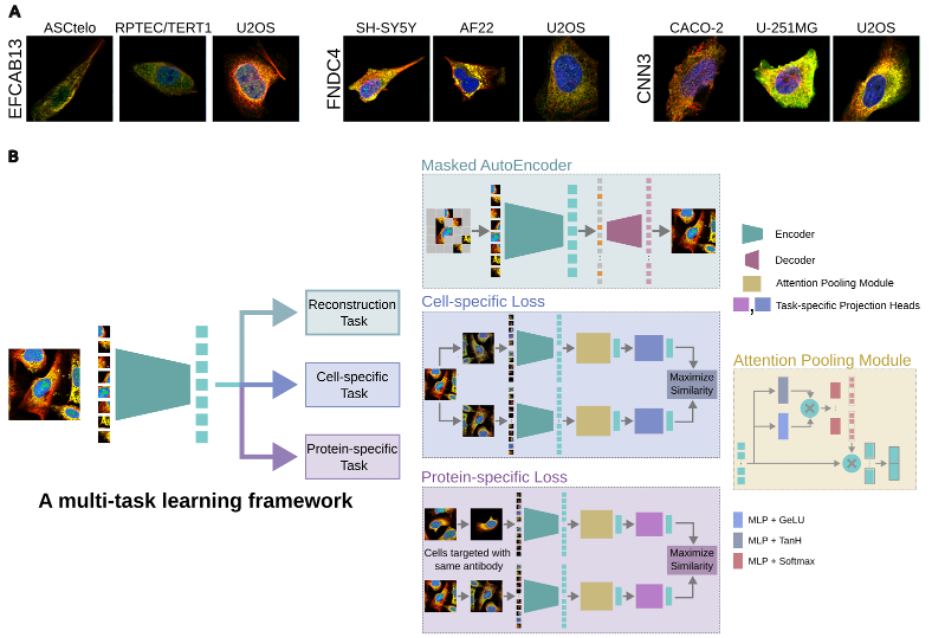

# SubCell: Proteome-aware vision foundation models for microscopy

This repository contains the training code for SubCell, described in:

> Gupta, A. *et al.* SubCell: Proteome-aware vision foundation models for microscopy capture single-cell biology. *bioRxiv* (2025). https://doi.org/10.1101/2024.12.06.627299

To compute embeddings or localization predictions with the trained models on your own images, use [SubCellPortable](https://github.com/CellProfiling/SubCellPortable).

## Overview
The cell is the functional unit of life, capable of performing a wide range of biological functions underpinned by a myriad of molecular interactions carefully organized in an intricate subcellular architecture. Cellular architecture can be studied with microscopy images at scale, and the present era of machine learning has enabled data-driven modeling of these images to reveal the cellular organization and function beyond what humans can readily perceive. Here, we introduce SubCell, a suite of self-supervised deep learning models designed to accurately capture cellular morphology and protein localization in fluorescent microscope images. The models were trained using the metadata-rich, proteome-wide image collection from the Human Protein Atlas. SubCell outperforms state-of-the-art methods in protein localization and cellular phenotyping. SubCell is generalizable to other fluorescent datasets spanning different imaging devices and resolutions, including a dataset of perturbed cells, where SubCell succeeds in predicting perturbations and mechanisms of action without any fine-tuning. Finally, we use SubCell to construct the first proteome-wide hierarchical map of proteome organization directly learned from image data.



*Figure 1: Overview of the SubCell self-supervised learning framework. (A) Representative images of single-cell crops from the Human Protein Atlas data set demonstrating the diverse cell morphologies and protein subcellular localizations present in a variety of human cells (Blue: Nucleus; Red: Microtubules; Yellow: endoplasmic reticulum; Green: Protein of interest). (B) Illustration depicting our multi-task learning approach to train a vision transformer model. We use three tasks to train our model: reconstruction, cell-specific, and protein-specific tasks.*

## Contents
- [System requirements](#system-requirements)
- [Installation guide](#installation-guide)
- [Demo](#demo)
- [Instructions for use](#instructions-for-use)
- [Reproducing the paper models](#reproducing-the-paper-models)
- [Repository structure](#repository-structure)
- [Data availability](#data-availability)
- [Code availability](#code-availability)
- [License](#license)
- [Citation](#citation)

## System requirements

### Hardware
- An NVIDIA GPU with CUDA support is required; training uses the NCCL backend and does not run on CPU.
- The demo was tested on a single NVIDIA A100 (80 GB).
- The models in the paper were trained on 16 NVIDIA H100 GPUs.

### Software
- Operating system: Linux. Tested on CentOS Linux 7.9 (kernel 3.10), NVIDIA driver 550.163.01.
- Python 3.12 (tested with 3.12.1).
- All Python dependencies are pinned in [`requirements.txt`](requirements.txt). Main packages and the versions tested:

| Package | Version |
| --- | --- |
| torch | 2.3.1 (CUDA 12.1 wheels) |
| torchvision | 0.18.1 |
| lightning | 2.3.3 |
| transformers | 4.41.2 |
| mosaicml-streaming | 0.7.3 |
| torchmetrics / torcheval | 1.3.0 / 0.0.7 |
| timm | 1.0.7 |
| numpy / pandas / scipy | 1.26.4 / 2.2.2 / 1.13.1 |
| scikit-learn | 1.5.1 |

## Installation guide

```bash
git clone https://github.com/CellProfiling/subcell-embed.git
cd subcell-embed

python3 -m venv .venv
source .venv/bin/activate
pip install --upgrade pip
pip install -r requirements.txt
```

The default PyTorch wheels are built for CUDA 12.1. If your driver needs another CUDA build, install `torch==2.3.1` and `torchvision==0.18.1` from https://pytorch.org/get-started/previous-versions/ first, then run `pip install -r requirements.txt`.

**Typical install time:** about 2 minutes on our test machine with a warm pip cache. A fresh install downloads about 3 GB of packages (mostly PyTorch and CUDA libraries), so it usually takes 5 to 10 minutes on a typical broadband connection. The installed environment takes about 5.5 GB of disk space.

A [`Dockerfile`](Dockerfile) that installs the same pinned requirements is also provided:
```bash
docker build -t subcell-embed .
docker run --gpus all -it subcell-embed
```

## Demo

The demo trains a small SubCell model (same objective as the paper: reconstruction, cell-specific and protein-specific losses) on a synthetic dataset, so it runs without downloading the Human Protein Atlas images. All commands are run from the repository root.

**1. Generate the synthetic dataset** (about 10 seconds, 113 MB):
```bash
python scripts/make_demo_data.py --out demo_data/hpa_mds_448
```
This writes 32 training and 8 validation samples in the same MDS format used for the Human Protein Atlas data. Each sample is one "antibody" with 8 single-cell crops (448 x 448 pixels, 4 channels plus a cell mask), where the protein channel is either nuclear or cytosolic.

**2. Train on one GPU** (about 6 minutes on one NVIDIA A100):
```bash
torchrun --nproc_per_node=1 --master_addr=127.0.0.1 --master_port=29500 \
    main_lightning.py -c configs/demo.yaml
```

**Expected output.** Training runs for 10 epochs (8 steps each, with validation after each epoch). The log ends with the line `` `Trainer.fit` stopped: `max_epochs=10` reached. `` Results are written to `demo_output/demo/rybg_448_nc4_contrast_mae_vit_tiny/ssl_model_ContrastiveLoss/`:

```
config_exp.yaml          # resolved configuration
models/                  # last.ckpt, best_model_ap.ckpt, best_model_mlrap.ckpt
valid_images/            # per-epoch feature and attention-pooling visualizations
metrics/                 # online_finetuning_map_df.csv and online_finetuning_map.png
lightning_logs/version_0/metrics.csv   # training and validation losses and metrics
```

The validation reconstruction loss (`val_loss/reconloss` in `metrics.csv`) should decrease steadily, from about 0.69 after the first epoch to about 0.66 after the tenth (seed 42). The localization metrics (`val_metrics/*`) are averaged over all 35 location classes, but only 2 classes occur in the synthetic data, so their values are low and not meaningful for the demo.

## Instructions for use

### Preparing your data
Training data is read with [MosaicML Streaming](https://github.com/mosaicml/streaming) from MDS shards. Each MDS sample corresponds to one antibody (protein) and contains all its single-cell crops:

| Column | Type | Content |
| --- | --- | --- |
| `antibody` | `str` | Antibody ID containing a number, e.g. `HPA000123` or `CAB010184`. Used as the protein label for the protein-specific loss. |
| `cell_line` | `str` | Cell line of each crop, joined with `;` |
| `plate_position` | `str` | Plate and well of each crop, joined with `;`. Together with `cell_line`, used to sample crops from different images. |
| `ensembl_ids`, `locations` | `str` | Gene IDs and location annotations, joined with `;` |
| `img` | `ndarray:uint16` | Array of shape `(n_cells, H, W, 5)`: channels are microtubules (red), ER (yellow), nucleus (blue), protein of interest (green), and a binary cell mask |
| `targets` | `ndarray:uint8` | Array of shape `(n_cells, 35)`: multi-hot location labels in the order of `annotations/location_group_mapping.tsv`, plus `Negative` |
| `bboxes` | `ndarray:uint16` | Array of shape `(n_cells, 4)`: crop bounding boxes in the original image |

[`scripts/make_demo_data.py`](scripts/make_demo_data.py) is a minimal example of writing data in this format with `streaming.MDSWriter`.

### Configuring and launching training
1. Set `data.train_remote_path` and `data.val_remote_path` in a config file to your MDS directories (local paths or `s3://` URIs). The string `hpa_mds` in these paths is replaced with `hpa_mds_<image_size>`, e.g. `data/hpa_mds/train` reads `data/hpa_mds_448/train`. Shards are cached under `.local/` in the working directory.
2. Set `exp_folder` to where outputs should be written, and `log_wandb: true` to log to Weights & Biases.
3. Launch with `torchrun` from the repository root. Batch sizes in the config are global and are divided across GPUs:
   ```bash
   # one node, 8 GPUs
   torchrun --nproc_per_node=8 --master_addr=127.0.0.1 --master_port=29500 \
       main_lightning.py -c configs/MAE-cellS-protS-contrast.yaml
   ```
   For several nodes, run the same command on every node with `--nnodes`, `--node_rank` and the address of the first node as `--master_addr`.
4. Training resumes automatically from `models/last.ckpt` if it exists in the experiment folder. Use `-r <seed>` to change the random seed (default 42).

If `torchrun --standalone` crashes with a segmentation fault on a machine without IPv6, pass `--master_addr=127.0.0.1` and `--master_port` instead, as shown above.

## Reproducing the paper models

The models were trained on single-cell crops from the Human Protein Atlas (v23) with the antibody-level train, validation and test splits in [`annotations/splits/`](annotations/splits), on 16 NVIDIA H100 GPUs. The configurations used are:

| Config | Training objective |
| --- | --- |
| `configs/MAE.yaml` | Masked autoencoder reconstruction only |
| `configs/cellS.yaml` | Cell-specific contrastive loss (ViT) |
| `configs/protS.yaml` | Protein-specific contrastive loss (ViT) |
| `configs/cellS-protS.yaml` | Cell- and protein-specific contrastive losses (ViT) |
| `configs/MAE-cellS-protS-contrast.yaml` | Reconstruction + cell-specific + protein-specific contrastive losses (SubCell) |
| `configs/MAE-cellS-protS-byol.yaml` | Reconstruction + cell-specific + protein-specific losses with a BYOL-style centroid objective |

All configs use 448 x 448 crops, 8 cells per antibody, a ViT-B/16 encoder and 300 epochs. All except `MAE.yaml` use gated attention pooling; `MAE.yaml` uses mean pooling.

## Repository structure
```
subcell-embed/
├── annotations/
│   ├── splits/                     # train / valid / test antibody IDs
│   └── location_group_mapping.tsv  # subcellular location classes
├── configs/                        # training configurations (see above), demo.yaml
├── data/                           # MDS datasets, collate functions
├── models/
│   ├── lightning/                  # LightningModules for each objective, callbacks
│   ├── attention_pooling.py        # gated attention pooling
│   ├── ntxent.py, centroid_diff.py # contrastive / centroid losses
│   ├── object_aware_mae.py         # ViT-MAE with cell-mask-aware masking
│   └── projectors.py, vit.py, focal_loss.py
├── scripts/make_demo_data.py       # synthetic demo dataset
├── utils/                          # augmentations, distributed helpers, colormaps
└── main_lightning.py               # training entry point
```

## Data availability
The Human Protein Atlas images used for training are available from https://www.proteinatlas.org. The antibody splits used for training, validation and testing are in [`annotations/splits/`](annotations/splits).

## Code availability
The source code is available at https://github.com/CellProfiling/subcell-embed under the MIT license. Code for inference with the trained models is available at https://github.com/CellProfiling/SubCellPortable.


## License
This project is released under the [MIT License](LICENSE), an OSI-approved open-source license.

## Citation
If you use this code, please cite (see also [`CITATION.cff`](CITATION.cff)):

```bibtex
@article{gupta2025subcell,
  title   = {SubCell: Proteome-aware vision foundation models for microscopy capture single-cell biology},
  author  = {Gupta, Ankit and Wefers, Zoe and Kahnert, Konstantin and Hansen, Jan N. and Misra, Mohini K. and Leineweber, Will and Cesnik, Anthony and Lu, Dan and Axelsson, Ulrika and Ballllosera, Frederic and Altman, Russ B. and Karaletsos, Theofanis and Lundberg, Emma},
  journal = {bioRxiv},
  year    = {2025},
  doi     = {10.1101/2024.12.06.627299}
}
```
